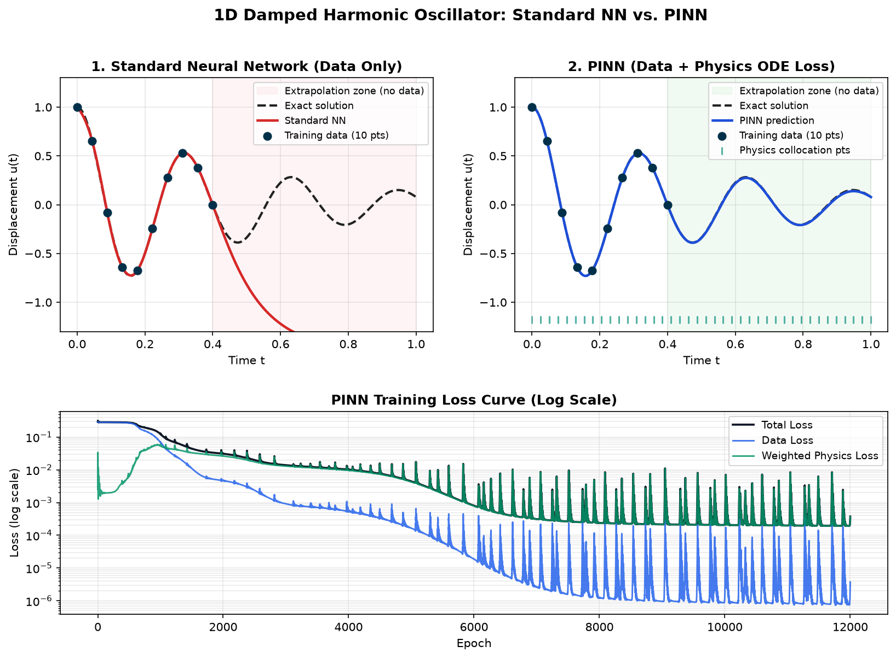
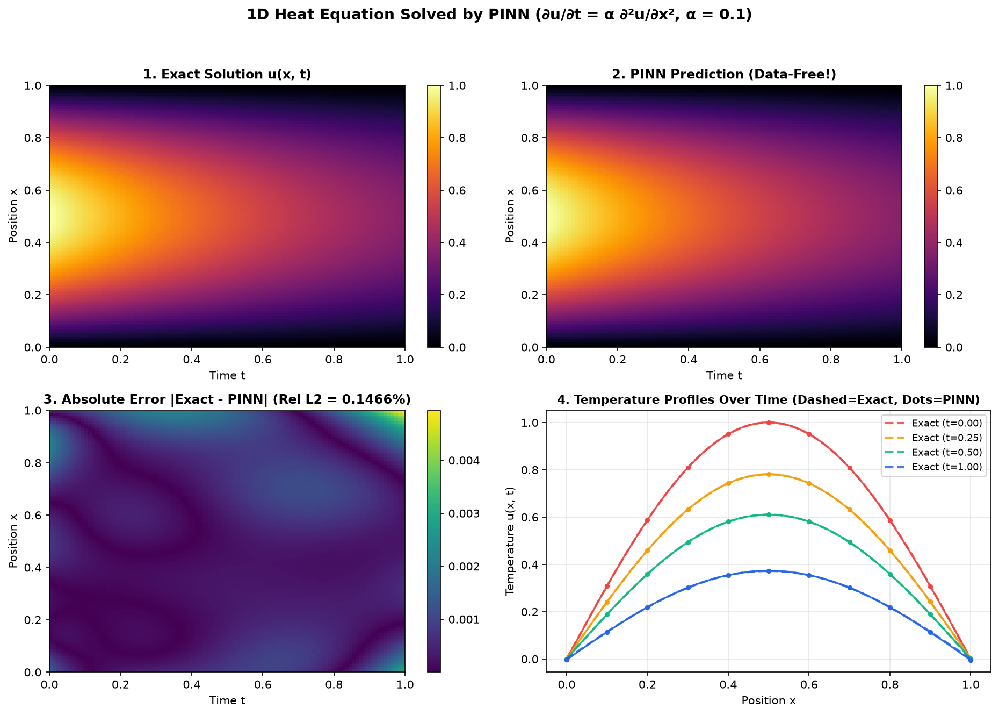

# PINN Starter (PyTorch)

**PINN (Physics-Informed Neural Network, 물리 정보 신경망)** 을 처음 접하는 분이 코드를 하나씩 뜯어보며 공부할 수 있도록 만든 입문용 프로젝트입니다.

딥러닝 프레임워크는 PINN 분야에서 가장 보편적으로 쓰이는 **PyTorch** 를 사용했습니다.

---

## 1. PINN이란 무엇인가요? (한 줄 요약)

일반 신경망은 **"관측 데이터만"** 보고 패턴을 외우지만,
PINN은 **"관측 데이터 + 알고 있는 물리 법칙(미분방정식)"** 을 손실 함수(Loss Function)에 함께 넣어 학습하는 신경망입니다.

$$\mathcal{L}_{\text{total}} = \mathcal{L}_{\text{data}} + \lambda \, \mathcal{L}_{\text{physics}}$$

여기서 핵심 기술은 **PyTorch의 자동미분(`torch.autograd.grad`)** 입니다.
신경망 출력 $u(t)$ 를 입력 좌표 $t$ (또는 $x, t$)에 대해 직접 미분해서 $\frac{du}{dt}$, $\frac{d^2u}{dt^2}$, $\frac{\partial^2 u}{\partial x^2}$ 를 구한 뒤, 물리 방정식에 대입했을 때 **0이 되도록(잔차 = 0)** 신경망을 학습시킵니다.

---

## 2. 프로젝트 구조

실무 및 오픈소스 머신러닝 프로젝트에서 가장 표준적으로 쓰는 디렉토리 구조를 따랐습니다.

```text
pinn-starter/
├── README.md                        # 현재 문서 (개념 설명 & 공부 가이드)
├── pyproject.toml                   # Python 프로젝트 설정 (uv / pip / pytest)
├── requirements.txt                 # 의존성 패키지 목록
├── src/
│   └── pinn/                        # 재사용 가능한 핵심 PINN 모듈
│       ├── model.py                 # [핵심 1] Tanh 기반 MLP 신경망
│       ├── autograd.py              # [핵심 2] 자동미분 유틸 (du/dt, d²u/dx²)
│       └── problems.py              # [핵심 3] 물리 방정식 잔차(Residual) & 해석해
├── examples/
│   ├── 01_harmonic_oscillator.py    # [예제 1] 1D 감쇠 조화 진동자 (일반 NN vs PINN 비교)
│   └── 02_heat_equation_1d.py       # [예제 2] 1D 열전도 방정식 (데이터 없이 PDE 풀기)
├── notebooks/
│   └── 01_pinn_walkthrough.ipynb    # 셀 단위로 천천히 따라가는 입문용 노트북
├── tests/
│   └── test_pinn.py                 # 자동미분 & 물리 방정식 검증 테스트
└── results/                         # 실행 결과 그래프 이미지
    ├── 01_harmonic_oscillator.png
    └── 02_heat_equation_1d.png
```

---

## 3. 추천 공부 순서 (하나씩 뜯어보기)

처음부터 끝까지 한 번에 다 이해할 필요는 없습니다. 아래 순서대로 파일을 열어보시면 가장 쉽게 이해됩니다.

1. **[`src/pinn/model.py`](src/pinn/model.py)** (약 50줄)
   - 일반 MLP와 똑같이 생겼지만, **왜 `ReLU` 대신 `Tanh`를 쓰는지** 확인하세요.
2. **[`src/pinn/autograd.py`](src/pinn/autograd.py)** (약 45줄)
   - PINN의 심장입니다. `torch.autograd.grad(..., create_graph=True)` 가 어떻게 동작하는지 주석을 읽어보세요.
3. **[`src/pinn/problems.py`](src/pinn/problems.py)** (약 110줄)
   - 물리 공식(ODE / PDE)이 코드 몇 줄짜리 `physics_residual` 함수로 어떻게 바뀌는지 확인하세요.
4. **[`examples/01_harmonic_oscillator.py`](examples/01_harmonic_oscillator.py)**
   - 똑같은 10개의 데이터로 일반 신경망과 PINN을 나란히 학습시켜 비교합니다.
   - `lambda_physics` 값을 `0.0` 으로 바꾸거나 데이터 개수를 바꿔보며 실험해보세요!
5. **[`examples/02_heat_equation_1d.py`](examples/02_heat_equation_1d.py)**
   - 시간($t$)과 공간($x$) 두 변수를 다루는 편미분방정식(PDE) 예제입니다.
   - 내부 정답 데이터가 **단 1개도 없이** 초기조건(IC) + 경계조건(BC) + PDE만으로 온도 변화를 풀어냅니다.

---

## 4. 포함된 2가지 대표 예제

### 예제 1: 1D 감쇠 조화 진동자 (Damped Harmonic Oscillator, ODE)

용수철에 매달린 물체가 마찰을 받으며 점점 멈추는 움직임을 설명하는 2계 상미분방정식입니다.

$$\frac{d^2 u}{dt^2} + \mu \frac{du}{dt} + k u = 0 \qquad (\mu = 4,\; k = 400)$$

- **실험 조건**: $t \in [0, 0.4]$ 앞구간에서만 단 10개의 점만 관측하고, 미래 구간 $t \in [0.4, 1.0]$ 을 예측합니다.
- **실행 결과 비교 (RMSE, 낮을수록 정확)**:

| 평가 구간 | 일반 신경망 (Standard NN) | PINN (물리 법칙 추가) |
| :--- | :---: | :---: |
| 전체 구간 $t \in [0.0, 1.0]$ | `0.99765` | **`0.00523`** (약 190배 정확) |
| 미래 외삽 구간 $t \in [0.4, 1.0]$ | `1.28794` | **`0.00648`** (약 198배 정확) |



### 예제 2: 1차원 열전도 방정식 (1D Heat Equation, PDE)

가운데가 뜨겁고 양 끝이 $0^\circ\text{C}$ 로 고정된 막대기가 시간이 지나며 식어가는 현상입니다.

$$\frac{\partial u}{\partial t} - \alpha \frac{\partial^2 u}{\partial x^2} = 0 \qquad (\alpha = 0.1,\; x \in [0, 1],\; t \in [0, 1])$$

- **초기조건 (IC)**: $u(x, 0) = \sin(\pi x)$
- **경계조건 (BC)**: $u(0, t) = 0,\; u(1, t) = 0$
- **핵심**: 내부 시공간 정답 데이터 **0개 (Data-Free)** 로 시공간 전체의 온도 분포를 복원합니다.
- **실행 결과**: 상대 L2 오차 **`0.1466%`**, 최대 절대 오차 **`0.00494`**



---

## 5. 내 컴퓨터에서 실행하기

```bash
# 1) 가상환경 생성 및 활성화
python3 -m venv .venv
source .venv/bin/activate        # Windows: .venv\Scripts\activate

# 2) 패키지 설치
pip install -r requirements.txt

# 3) 단위 테스트 실행 (자동미분 & 물리 공식 검증)
pytest -v

# 4) 예제 실행 (CPU에서도 수십 초 내에 완료됩니다)
python examples/01_harmonic_oscillator.py
python examples/02_heat_equation_1d.py
```

---

## 6. 다음 단계로 해볼 만한 실험 (공부용 미션)

코드를 뜯어보신 뒤 아래 실험들을 직접 바꿔 실행해보면 PINN의 감이 확 잡힙니다:

- [ ] `model.py` 에서 `nn.Tanh()` 를 `nn.ReLU()` 로 바꾸면 어떻게 망가지는지 직접 확인해보기
- [ ] `01_harmonic_oscillator.py` 에서 `lambda_physics` 를 `1e-1` 이나 `1e-6` 으로 바꿨을 때 학습이 어떻게 달라지는지 관찰하기
- [ ] `01_harmonic_oscillator.py` 에서 관측 데이터(`t_data`)에 약간의 노이즈(`+ 0.05 * torch.randn_like(u_data)`)를 섞어도 PINN이 잘 버티는지 확인해보기
- [ ] `02_heat_equation_1d.py` 에서 열확산 계수 `alpha` 를 `0.05` 나 `0.3` 으로 바꿔 식는 속도 비교해보기
- [ ] (심화) 관측 데이터로부터 미지의 물리 상수 `mu` 나 `alpha` 를 거꾸로 찾아내는 **Inverse PINN** 구현해보기
